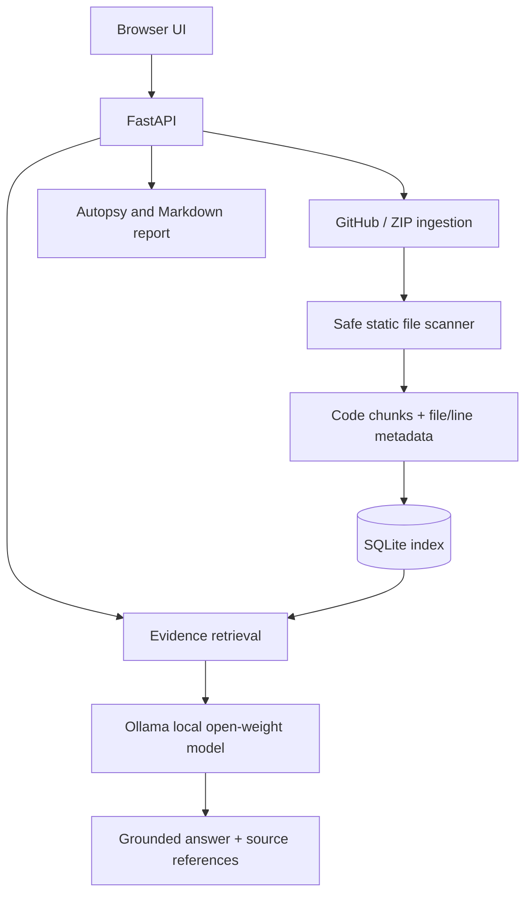

# Repo Séance architecture

## Trust boundaries

Imported repositories are untrusted. The MVP reads text files only and does not execute project code. The model receives retrieved text as evidence and is explicitly instructed not to follow instructions contained in that text. Secret filtering is best-effort and is not a substitute for reviewing the data before upload.
